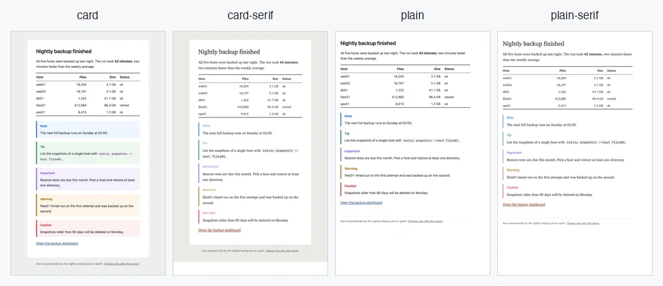

<p align="center"></p>

# Mailfire

[](https://github.com/thorstenkramm/mailfire/actions/workflows/ci.yml)
[](https://github.com/thorstenkramm/mailfire/releases/latest)
[](https://github.com/thorstenkramm/mailfire/blob/main/go.mod)
[](LICENSE)

Send plain-text, Markdown, and HTML email from the command line through Mailgun, Gmail, or SMTP.

**Documentation: <https://mailfire.system42.io>**

- Three sending providers: the Mailgun API (default), Gmail with send-only OAuth, and standard SMTP submission
- Four built-in email templates, plus support for custom templates
- Attachments, inline Markdown images, and GitHub-style alerts
- Mailgun test mode to validate requests without delivering email
- Local HTML preview without credentials or network access
- Logging and deferred delivery with retry support
- Opt-in deduplication of repeated notifications
- JSON output for scripts and monitoring

[](https://mailfire.system42.io/guides/templates/#screenshots)

## Installation

On macOS, install with [Homebrew](https://brew.sh):

```shell
brew tap thorstenkramm/tap
brew trust --cask thorstenkramm/tap/mailfire
brew install --cask mailfire
```

On Linux, use the signed [APT and DNF repositories](https://mailfire.system42.io/getting-started/linux-packages/).
Every [GitHub release](https://github.com/thorstenkramm/mailfire/releases) also includes binaries for Linux, macOS,
and Windows, DEB and RPM packages, and checksums. See [Installation](https://mailfire.system42.io/getting-started/installation/)
for all options, including building from source.

## Quick start

Create `.mailfire.conf` in your current directory with your Mailgun API key, region (`us` or `eu`), sending domain,
and sender — or configure [SMTP](https://mailfire.system42.io/guides/smtp/) or
[Gmail](https://mailfire.system42.io/guides/gmail/) instead:

```toml
[mailgun]
api_key = "<your-api-key>"
region = "eu"

[sending]
domain = "example.com"
from = "My Name <user@example.com>"
```

Check the setup, then send a Markdown email:

```shell
chmod 600 .mailfire.conf
mailfire validate
mailfire --md --to user@example.com --subject "Have a nice day" <<EOF
# This is an email

It is written in Markdown and delivered as HTML.
EOF
```

The [quick start guide](https://mailfire.system42.io/getting-started/quick-start/) explains each step.

## Documentation

- [Getting started](https://mailfire.system42.io/getting-started/): installation and quick start
- [Guides](https://mailfire.system42.io/guides/): formats, templates, providers, deferred delivery, deduplication, and
  scripting
- [Reference](https://mailfire.system42.io/reference/): command line, configuration, environment variables, JSON
  output, exit codes, and the man page

The site is built from [`docs/`](docs/) with Hugo; run `make docs-serve` to preview it locally. The annotated example
configuration is [`mailfire.example.conf`](mailfire.example.conf).

## License

[MIT](LICENSE)
