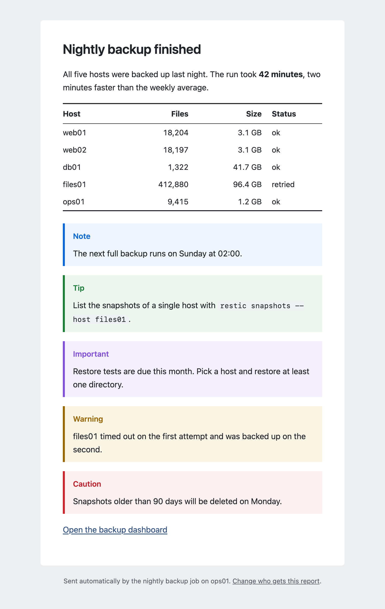
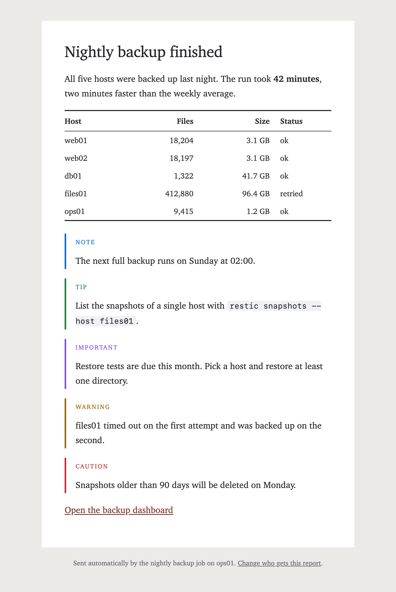
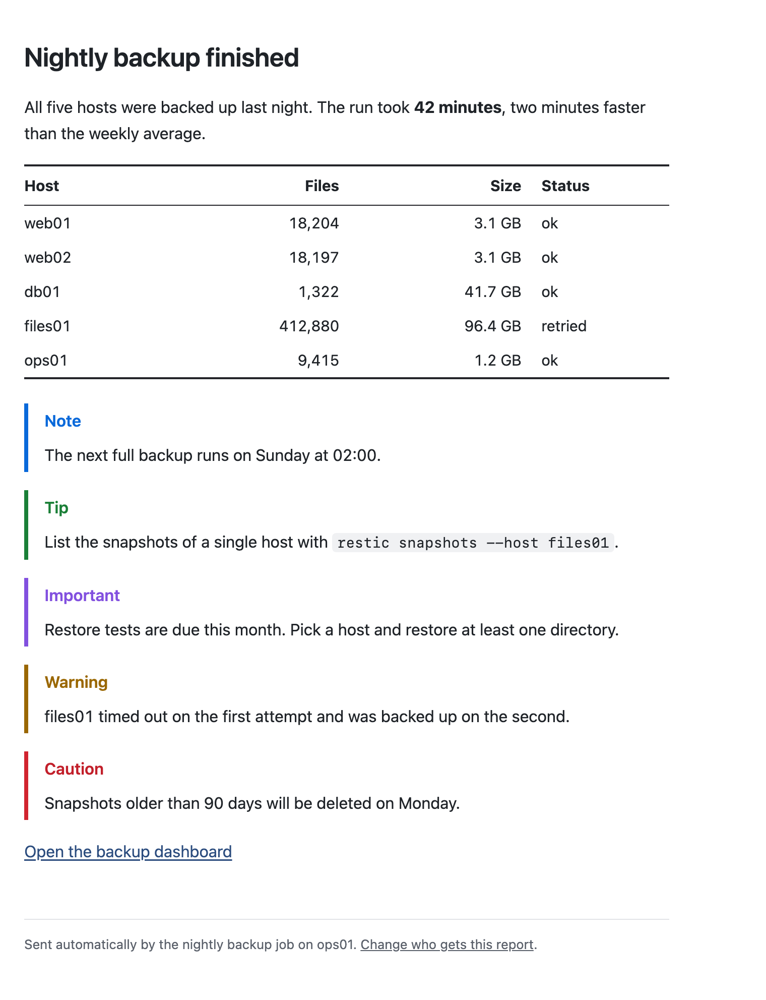
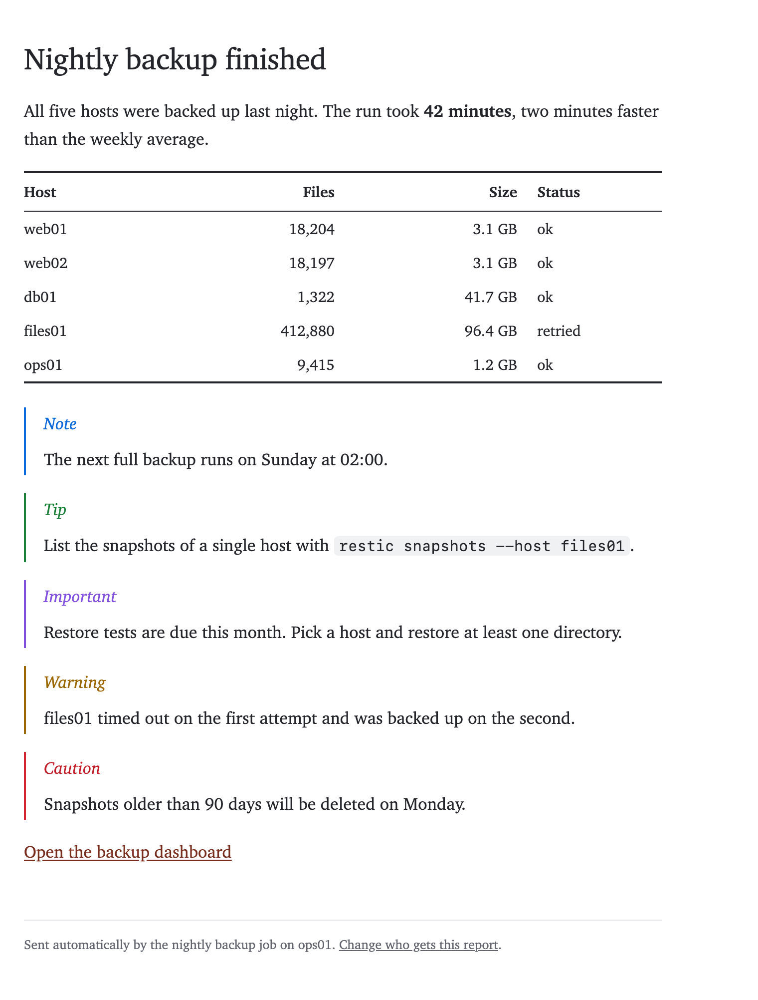

# Templates

`--md` and `--html` bodies are wrapped in one of four built-in templates. There are two layouts, `card` and `plain`, and each comes in a sans-serif and a serif variant.

| Template      | Layout                                          | Font       |
|---------------|-------------------------------------------------|------------|
| `card`        | white card, 600 px wide, centered on a gray page | sans-serif |
| `card-serif`  | white card, 600 px wide, centered on a gray page | serif      |
| `plain`       | no background, left aligned, up to 640 px wide  | sans-serif |
| `plain-serif` | no background, left aligned, up to 640 px wide  | serif      |

`card` is the default. To use another template for a single email, pass `--template`:

```shell
mailfire --md --template plain-serif --to user@example.com --subject "Nightly backup finished" --file report.md
```

To change the default, set `template` in the `[sending]` section of `mailfire.conf`:

```toml
[sending]
  template = "plain"
```

All templates support dark mode and small screens, and they render in Outlook.

## Fonts

The fonts come with the operating system, so nothing is downloaded. Each font list starts with fonts that are installed by default on macOS/iOS, Windows, Android and Linux. Arial and Times New Roman are only used if none of the others is available.

- **Sans-serif:** system-ui, -apple-system, Segoe UI, Roboto, Helvetica Neue, Noto Sans, Liberation Sans, Arial
- **Serif:** Charter, Bitstream Charter, Sitka Text, Cambria, Georgia, Times New Roman

## Alerts

In Markdown bodies you can use GitHub-style alerts. Each template gives them its own look, as shown in the screenshots below:

```markdown
> [!NOTE]
> The next full backup runs on Sunday at 02:00.

> [!TIP]
> List the snapshots of a single host with `restic snapshots --host files01`.

> [!IMPORTANT]
> Restore tests are due this month. Pick a host and restore at least one directory.

> [!WARNING]
> files01 timed out on the first attempt and was backed up on the second.

> [!CAUTION]
> Snapshots older than 90 days will be deleted on Monday.
```

As on GitHub, the marker must be on its own line, and alerts only work at the top level, not inside lists or other quotes. In the plain-text part of the email, an alert appears as a quote that starts with its type, e.g. `> NOTE`.

## Screenshots

All screenshots show the same message, sent with `--md`, `--preheader` and `--footer`.

### card



### card-serif



### plain



### plain-serif


